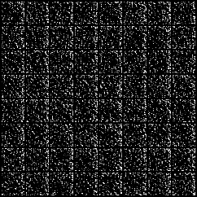
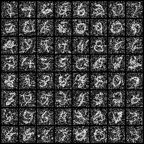

# MNIST Flow Experiments

An experimental PyTorch project exploring time-conditioned image generation on handwritten digits: a residual U-Net, Fourier time embeddings, and multi-step Heun sampling.

[Generate samples](#generate-samples) · [Train](#train) · [Implementation notes](docs/implementation.md)

<table>
  <tr><th>Saved initial sample</th><th>Saved sample at step 120,000</th></tr>
  <tr>
    <td></td>
    <td></td>
  </tr>
</table>

*Actual saved outputs from this repository. These grids show an exploratory result, with substantial noise and incomplete digit structure. The training configuration and random seed for these historical images were not recorded.*

## What is implemented

- A U-Net-style convolutional model with residual blocks and Fourier time conditioning.
- A local velocity-regression loss plus a Monte Carlo average-velocity penalty.
- AdamW optimization, cosine learning-rate decay, gradient clipping, and resumable model/optimizer checkpoints.
- Heun integration from Gaussian noise to a grid of 28 × 28 images.

The repository name reflects an exploration inspired by MeanFlow. The implemented objective and multi-step sampler differ from the published one-step method; this is an experiment, not a reproduction of the paper's results. See the [method comparison](docs/implementation.md#relationship-to-flow-matching-and-meanflow).

## Setup

Use Python 3.10 or later and a matched PyTorch/torchvision installation. CUDA is used when available; otherwise the scripts use CPU. Training can be expensive on CPU.

```sh
git clone https://github.com/sudhanvad18/MeanFlow_Handwritten_Digits.git
cd MeanFlow_Handwritten_Digits
python -m venv .venv
source .venv/bin/activate
python -m pip install -r requirements.txt
```

For a specific GPU installation, follow the [PyTorch installation selector](https://pytorch.org/get-started/locally/).

## Generate samples

Run from the repository root with the compatible checkpoint at `checkpoints/meanflow_mnist.pth`. That checkpoint is tracked in the inspected repository state.

```sh
python generate.py
```

This writes 64 samples to `outputs/generated_digits.png`, using 200 Heun steps by default. Each step performs two model evaluations. For a smaller generation run:

```sh
N_SAMPLES=8 SAMPLE_STEPS=20 OUTPUT_FILE=preview.png python generate.py
```

Samples start from newly drawn noise, so repeated runs differ. A missing checkpoint produces a `FileNotFoundError`; generation does not download MNIST.

## Train

```sh
python MeanFlow_Train.py
```

Training downloads MNIST into `data/`, writes sample grids into `samples/`, and saves to `checkpoints/meanflow_mnist.pth`. Configuration lives at the top of `MeanFlow_Train.py`.

**Checkpoint behavior matters:** the inspected checkpoint records step 120,000, while the script defaults to `MAX_STEPS = 100000`. With that checkpoint, the loop performs no further training. Move the existing checkpoint to a backup location before a fresh run, or set a higher `MAX_STEPS` to continue. Optimizer state is restored, but the scheduler and random-number state are not.

## Project map

| Path | Purpose |
| --- | --- |
| `MeanFlow_Train.py` | Model, losses, sampler, and training entry point |
| `generate.py` | Generation from saved weights |
| `docs/implementation.md` | Objective details, configuration, and limitations |
| `docs/assets/` | Small, curated copies of existing outputs |
| `tests/test_entrypoints.py` | Import-safety regression checks |

## Checks and current scope

```sh
python -m unittest discover -s tests -v
```

The existing outputs are qualitative examples. FID, inference latency, and comparisons with baselines have not been established. EMA loading is supported when a checkpoint contains EMA weights, but the current training path disables EMA and the inspected checkpoint contains none.

## Background

- Lipman et al., [Flow Matching for Generative Modeling](https://arxiv.org/abs/2210.02747), ICLR 2023.
- Geng et al., [Mean Flows for One-step Generative Modeling](https://arxiv.org/abs/2505.13447), NeurIPS 2025; [official implementation](https://github.com/Gsunshine/meanflow).
- The previous README also referenced [haidog-yaqub/MeanFlow](https://github.com/haidog-yaqub/MeanFlow), an unofficial PyTorch implementation.

These references provide background; this repository makes no claim to reproduce their reported results.
